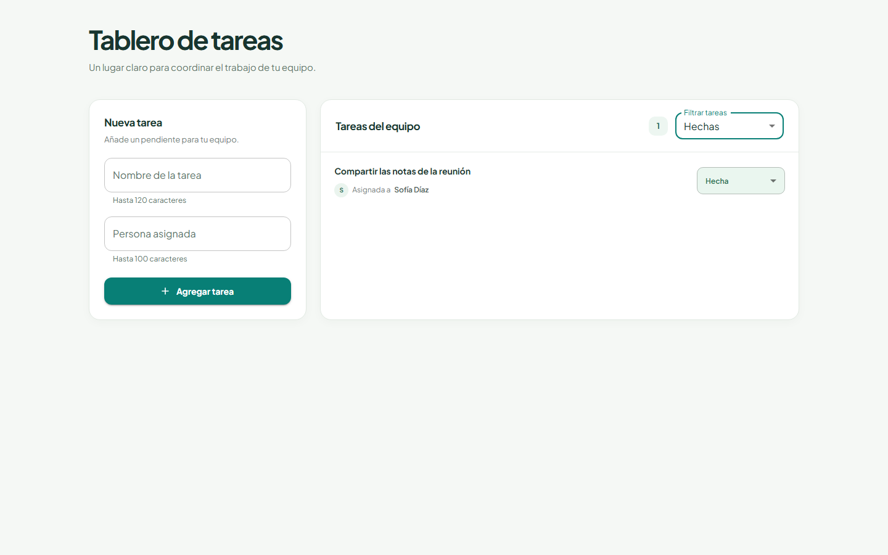

# Interfaz del gestor de tareas

Aplicación React y TypeScript para crear tareas, filtrar y paginar resultados desde el servidor y cambiar estados. La interfaz está en español y separa presentación, formularios, datos remotos y transporte HTTP.

- Aplicación: https://react-node-task-manager-web.onrender.com
- Backend y Docker Compose: https://github.com/guillerg01/react-node-task-manager-api
- Swagger: https://react-node-task-manager-api.onrender.com/docs
- Arquitectura: https://github.com/guillerg01/react-node-task-manager-api/blob/main/ARCHITECTURE.md
- Decisiones y uso de IA: https://github.com/guillerg01/react-node-task-manager-api/blob/main/DECISIONS.md



[Captura móvil](docs/images/dashboard-375.png) · [Captura tablet](docs/images/dashboard-768.png)

## Ejecutar todo con Docker

Clona ambos repositorios como carpetas hermanas. Con Docker iniciado:

```sh
git clone https://github.com/guillerg01/react-node-task-manager-api.git
git clone https://github.com/guillerg01/react-node-task-manager-web.git
cd react-node-task-manager-api
docker compose up --build
```

Abre http://localhost:5174. La API está en http://localhost:3001 y Swagger en http://localhost:3001/docs. Compose configura los servicios, espera sus comprobaciones de salud y aplica migraciones. Un volumen conserva PostgreSQL entre reinicios.

Para desarrollar únicamente la web, usa la versión de Node de `.nvmrc`:

```sh
npm ci
npm run dev
```

## Variables de entorno

Copia `.env.example` a `.env.local`. `VITE_API_URL` define el origen público del backend, sin `/api`; el cliente compartido añade ese prefijo. El ejemplo apunta a la API de Compose en el puerto 3001. La API nativa usa 3000 por defecto. Sin configuración, el desarrollo de Vite apunta a http://localhost:3000.

Vite incorpora el valor durante la compilación. Reinicia el servidor de desarrollo después de cambiarlo. No contiene secretos. Compose ya proporciona su valor de compilación y Render configura el origen de producción en el servicio. Los archivos reales de entorno están excluidos de Git; únicamente se versiona la plantilla.

Playwright acepta `E2E_BASE_URL` y `E2E_API_URL` como variables del proceso, con valores predeterminados http://localhost:5174 y http://localhost:3001. Se exportan en la terminal antes de ejecutar las pruebas; Playwright no carga `.env.local` automáticamente.

## Arquitectura y responsabilidades

| Ubicación | Responsabilidad |
| --- | --- |
| `src/features/tasks/components` | Formulario, tablero, lista, filtro y presentación de cada tarea |
| `src/features/tasks/hooks/useTasks.ts` | Consultas, escrituras, reconciliación de caché y conflictos |
| `src/features/tasks/api` | Operaciones HTTP tipadas de tareas |
| `src/features/tasks/taskFilterStorage.ts` | Persistencia del filtro seleccionado |
| `src/shared/components` | Campos validados y paginación reutilizables |
| `src/shared/notifications` | Cola de notificaciones, contexto y presentación accesible |
| `src/api` | Instancia Axios y normalización de errores de transporte |
| `src/app` | Proveedor global de consultas |

`useTasks` pertenece a la feature porque conoce estados, rutas y claves de tareas. Moverlo a una carpeta genérica ocultaría esa dependencia. Los componentes compartidos pueden reutilizarse sin importar reglas de tareas.

React utiliza componentes funcionales. Las clases de NestJS responden a su modelo de inyección de dependencias y no se trasladan al frontend. Cada módulo conserva una responsabilidad concreta, sin añadir un almacén global para datos que TanStack Query ya gestiona.

## Decisiones técnicas

- **React y Vite:** aplicación pequeña, compilación enfocada y despliegue estático.
- **Material UI y Tailwind:** controles establecidos y utilidades de distribución. Cada feature conserva etiquetas y comportamiento específico.
- **React Hook Form:** valores, validación, envío y errores de campos. Se recortan los textos; título y responsable admiten 120 y 100 caracteres. Un fallo conserva el borrador y una creación correcta reinicia el formulario.
- **Axios compartido:** una instancia de módulo creada con `axios.create` centraliza origen y timeout de diez segundos. El interceptor de respuesta normaliza errores HTTP, de red y timeout, preservando cancelaciones. El módulo comparte la instancia sin necesitar una clase singleton.
- **TanStack Query:** controla datos remotos, vigencia, cancelación e invalidación. React Hook Form no controla la caché de consultas.
- **Una ruta:** existe una pantalla en `/`, por lo que no se añade una biblioteca de enrutado. Filtro y página son estado local; solamente el filtro persiste en el navegador.

### Caché y escrituras

La clave es `['tasks', statusFilter, page, pageSize]`, con 30 segundos de vigencia y sin recarga automática al enfocar la ventana. PostgreSQL filtra y pagina; el navegador no descarga todas las tareas para filtrarlas localmente.

Crear invalida las consultas de tareas y actualiza la vista activa. Cambiar estado utiliza la respuesta guardada para actualizar la fila si sigue perteneciendo a la vista, evitando un GET innecesario. Si cambia su pertenencia al filtro, se vuelve a consultar la página y el total. Las demás vistas almacenadas quedan invalidadas. Las escrituras pendientes se reconcilian con el filtro y página actuales cuando llega la respuesta.

No se reintentan escrituras automáticamente: un fallo de red puede ocurrir después de guardar y repetir podría duplicar una creación. Un `409` indica que otro cliente cambió la versión; se refrescan los datos y se permite un reintento deliberado. No hay sincronización en tiempo real: un cambio externo se observa en una lectura posterior o al recargar.

### Notificaciones, errores y accesibilidad

El proveedor genérico de Material UI Snackbar/Alert encola notificaciones de éxito al crear y cambiar estado. Se cierran manualmente o después de cinco segundos. Si falta el proveedor, el tablero mantiene una confirmación en línea como alternativa. Los errores de escritura permanecen visibles, los errores de lectura ofrecen reintento y los errores de validación aparecen junto al campo.

El transporte distingue `400`, `404`, `409`, `429`, errores del servidor, red y timeout. Reconocer `429` no significa que la API implemente limitación de peticiones.

Los controles tienen etiquetas accesibles y errores asociados. Los estados usan texto además de color; las notificaciones usan roles de región viva. El diseño se apila en pantallas estrechas. Se revisaron tamaños de 375, 768 y 1440 píxeles, foco, interacciones y ausencia de desbordamiento horizontal. Queda pendiente una auditoría completa con lectores de pantalla.

## Verificación

```sh
npm run lint
npm run typecheck
npm test
npm run build
```

Con Compose iniciado:

```sh
npx playwright install chromium
npm run test:e2e
```

| Nivel | Comportamiento comprobado |
| --- | --- |
| Unitario | Persistencia del filtro y clasificación de errores |
| Integración de interfaz | Testing Library y MSW: validación, consultas, filtros, paginación, escrituras, borradores, caché, respuestas 429 y conflictos |
| Navegador | Playwright sobre frontend, API y PostgreSQL reales: creación, estados, cierre de notificaciones, filtros, recarga, paginación y fallos de red controlados |

La base verificada contiene 30 pruebas de frontend y nueve recorridos de navegador en tres tamaños. Los casos de error interceptan respuestas para comprobar recuperación sin interrumpir producción. Las capturas complementan las aserciones con inspección visual; no equivalen a una auditoría completa de accesibilidad.

## Ramas, CI y despliegue

Crea `feature/*` o `fix/*` desde `dev`, abre un pull request a `dev` y promueve mediante otro a `main`. `main` representa producción. Los commits incluyen título y cuerpo descriptivos del comportamiento y su verificación.

GitHub Actions está configurado para pushes y pull requests. Instala dependencias bloqueadas, audita, comprueba lint y tipos, ejecuta pruebas y compila. El trabajo de navegador obtiene ambos repositorios y levanta Docker. Utiliza la rama compañera `dev` para integración y `main` para producción.

Render compila y publica `dist` desde `main` después de comprobaciones correctas. La API se despliega por separado: los dos repositorios no ofrecen una publicación atómica y un cambio incompatible exigiría coordinación y compatibilidad durante la transición.

## Límites y mejoras futuras

Es una prueba pequeña. No implementa autenticación, propiedad por usuario, actualizaciones en tiempo real ni monitorización de producción. Antes de manejar datos sensibles añadiría control de acceso, observabilidad, copias verificadas y protección de publicaciones. La API gratuita de Render puede tardar en despertar y su base gratuita tiene duración limitada.

## Uso de IA y forma de trabajo

Se pidió a la IA comparar herramientas, proponer límites de features, implementar partes delimitadas y sugerir pruebas y documentación. Subagentes Luna trabajaron en API, interfaz y pruebas con un contrato compartido. Se aceptaron Material UI, React Hook Form, Axios compartido y pruebas de red con MSW.

Las propuestas se revisaron contra las reglas y el comportamiento real. Se ajustaron caché durante cambios de filtro, foco, alineación, validación y concurrencia mediante inspección y pruebas. El agente principal realizó la integración y revisión final. Las herramientas de navegador apoyaron la inspección y configuración de Render; Playwright permitió comprobaciones repetibles cuando el navegador integrado dejó de estar disponible.

El [registro de decisiones](https://github.com/guillerg01/react-node-task-manager-api/blob/main/DECISIONS.md) explica herramientas, contexto, decisiones aceptadas, correcciones y límites de verificación. El uso de IA se declara porque la prueba lo solicita expresamente; los resultados y las limitaciones documentadas permiten evaluar la entrega.
